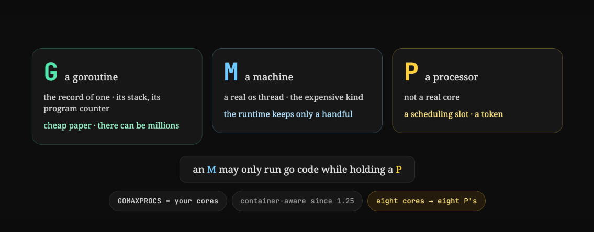

# Goroutines and Scheduler



# GMP Model in Go — How the Go Scheduler Works

Go uses the GMP scheduling model to run thousands of goroutines efficiently on a relatively small number of OS threads.

The three components are:

| Component | Full form | Responsibility                                                 |
| --------- | --------- | -------------------------------------------------------------- |
| G         | Goroutine | Represents a task to execute                                   |
| M         | Machine   | An OS thread that executes Go code                             |
| P         | Processor | A scheduler resource required by an M to execute Go goroutines |

The most important concept is:

G = What to execute, M = Who executes it, P = What enables and organizes its execution.

## 1. Visual mental model

Conceptual example: two Ps each have their own runnable queue and are attached to an M. The M executes the goroutine using CPU time.

## 2. What exactly does P do?

A common misunderstanding is thinking that P is a CPU or thread.

P is neither. P is a logical scheduler resource managed by the Go runtime.

It has four major responsibilities.

### A. Maintains a local goroutine run queue

Each P maintains a queue of runnable goroutines.

For example:

```
P1 local queue: [G1, G2, G3, G4]

M1 + P1:
   Execute G1
   Execute G2
   Execute G3
   ...
```

The P helps the runtime decide which goroutine should run next. The M actually executes that goroutine.

### B. Controls Go's execution parallelism

The number of Ps is controlled by `GOMAXPROCS`.

```
runtime.GOMAXPROCS(2)
```

This means:

- At most 2 goroutines can be actively executing Go code in parallel under normal scheduling.
- Go may still create more than 2 OS threads.
- You can have thousands or millions of goroutines, subject to available resources.

Important: `GOMAXPROCS = 2` does not mean Go creates only two threads.

### C. Stores runtime resources and scheduling state

P contains or manages runtime state used by the scheduler, including:

- Local runnable goroutine queue
- Allocation caches (`mcache`)
- Scheduling and timer-related state
- Other per-P runtime resources

This reduces contention because every goroutine does not need to access a single shared global queue or allocator cache.

### D. Enables work stealing

Suppose:

```
P1: [G1, G2, G3, G4, G5, G6]
P2: []  <-- idle
```

P2 can steal runnable goroutines from P1's queue, allowing both processors to stay busy.

This is called work stealing, which helps distribute work across available execution resources.

## 3. What happens when a goroutine blocks?

This is where the separation between M and P becomes particularly useful.

Imagine `G1` makes a blocking system call:

Before blocking

M1 owns P1 and executes G1.

G1 enters a blocking syscall

1. G1 is executing on M1 using P1.
2. G1 enters a blocking system call.
3. The runtime can detach P1 from M1.
4. P1 can be attached to another thread, M2.
5. M2 continues executing other runnable goroutines.
6. When G1's syscall completes, M1 needs to acquire a P before resuming Go execution.

This is a simplified blocking-syscall example. Network I/O commonly uses Go's nonblocking network poller, so a goroutine waiting for network data often does not block its OS thread at all.

## 4. Why can't Go simply use G + M without P?

Without P, the runtime would need another way to coordinate runnable goroutines and shared execution resources.

P provides:

| Without per-P resources                              | With P                                               |
| ---------------------------------------------------- | ---------------------------------------------------- |
| Potential contention on centralized work queues      | Local queues reduce contention                       |
| Shared allocator-state contention                    | Per-P allocation caches                              |
| Scheduling work is harder to distribute efficiently  | Work stealing between Ps                             |
| OS thread count could dictate scheduling parallelism | Parallelism controlled independently by `GOMAXPROCS` |

The design also allows an OS thread to block while its P is reused elsewhere. This separation is central to Go's scheduler architecture.&#x20;

[image](https://www.google.com/s2/favicons?domain=https://go.dev\&sz=32)

Go+1


## 5. Practical Go example

```
package main

import (
    "fmt"
    "runtime"
    "sync"
)

func main() {
    runtime.GOMAXPROCS(2)

    var wg sync.WaitGroup

    for i := 1; i <= 10; i++ {
        wg.Add(1)

        go func(id int) {
            defer wg.Done()
            fmt.Println("Running goroutine:", id)
        }(i)
    }

    wg.Wait()
}
```

Here you have:

- 10 Gs: Ten goroutines are created.
- 2 Ps: At most two goroutines execute Go code in parallel.
- Ms: OS threads execute those goroutines using the Ps.

The execution order is nondeterministic. Also, even with two Ps, the runtime might not use two CPU cores simultaneously for such short tasks.

## 6. Interview mental model

Remember these three statements:

- G contains the goroutine's execution state.
- M is the actual OS thread on which Go instructions run.
- P holds the scheduling resources and permission required for M to execute goroutines.

A P does not execute instructions itself. A P is attached to an M, and together they execute a G.

One interesting interview question: If `GOMAXPROCS=1`, can Go still handle 10,000 concurrent HTTP connections?

Yes. Go can manage many concurrent connections through goroutines and its network poller, even with one P. It cannot execute CPU-bound Go code on more than one CPU simultaneously in that configuration.

That's the distinction between concurrency and parallelism in Go.